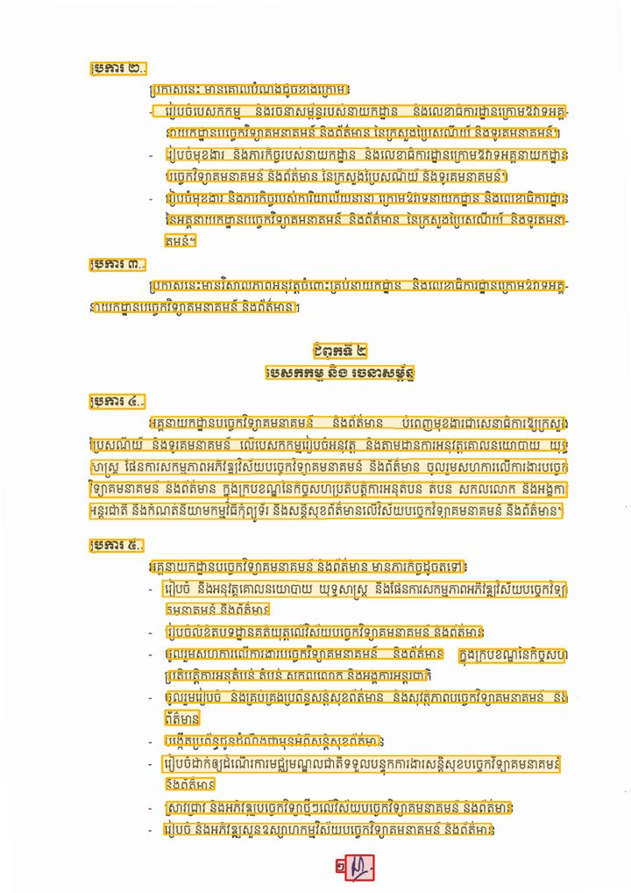
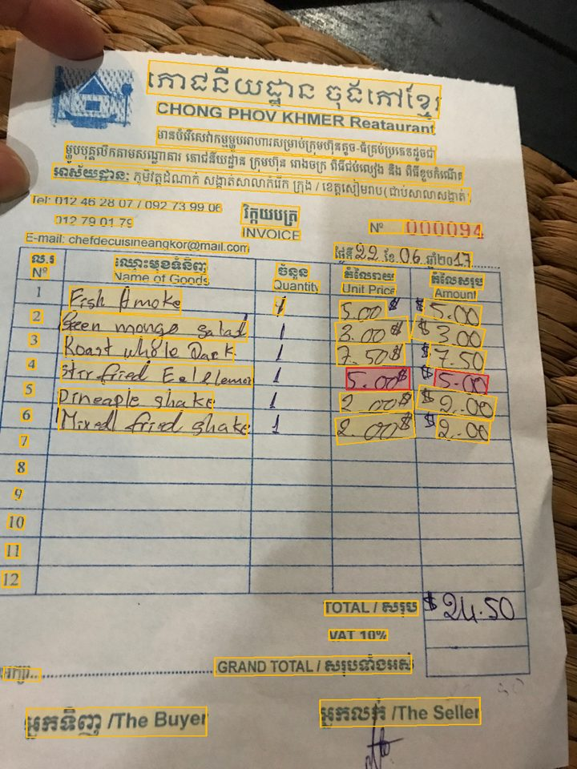
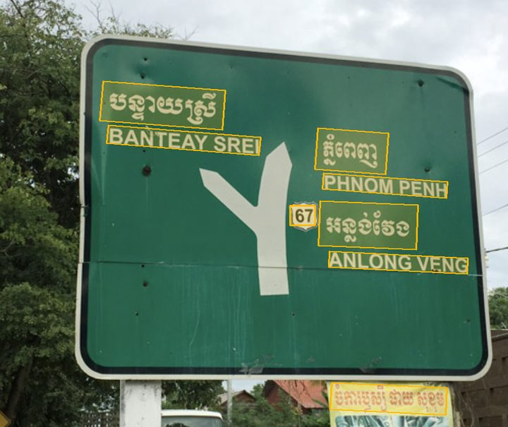
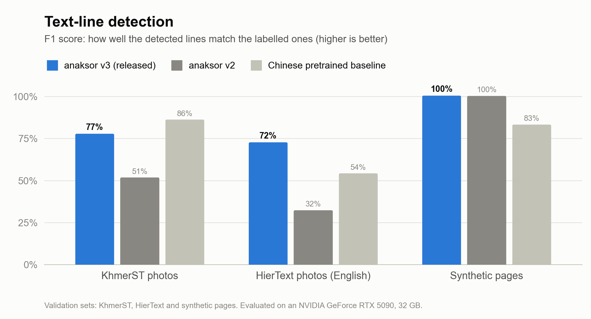
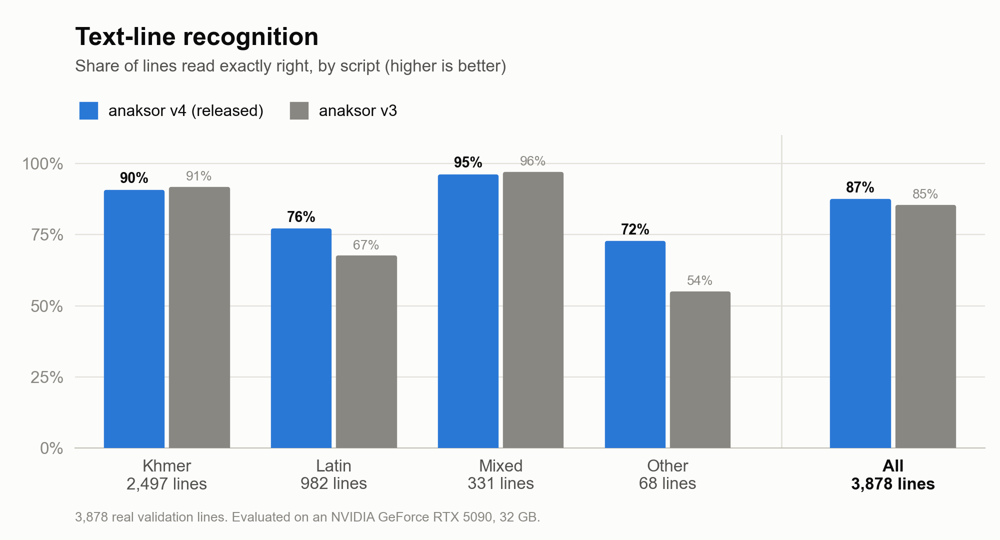
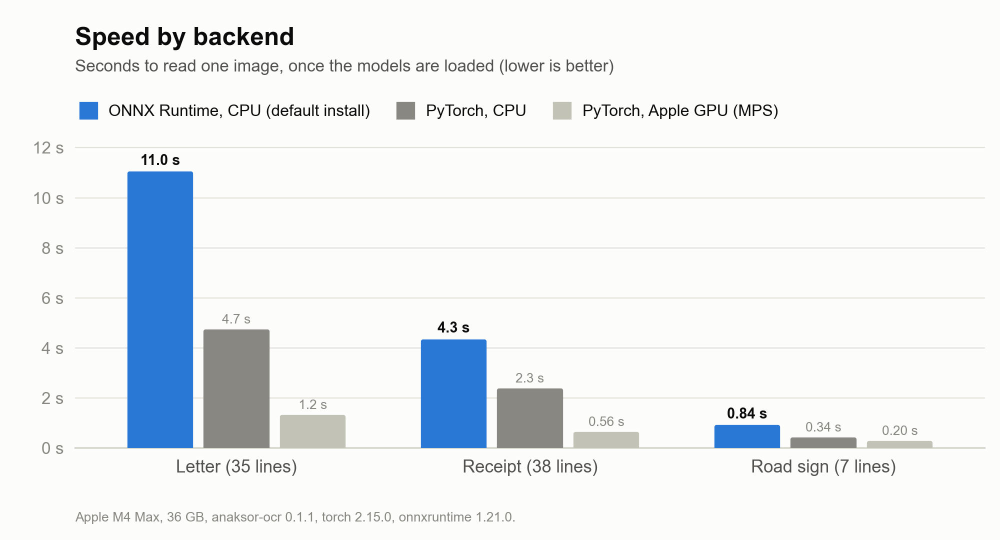

# anaksor-ocr

[](https://pypi.org/project/anaksor-ocr/)
[](https://pypi.org/project/anaksor-ocr/)
[](https://github.com/SokhengDin/anaksor-ocr/actions/workflows/ci.yml)
[](LICENSE)
[](https://huggingface.co/Sokheng/anaksor-ocr)

**អានអក្សរ**: Khmer OCR for photos, scans and PDFs. It finds the text lines, reads them,
puts them in reading order (columns, receipts, paragraphs) and exports plain text, JSON, a
searchable PDF or a Word file.

**[Try it in your browser →](https://ocr.sokhengdin.dev)**: drop a photo or PDF and see every
line it finds. The documentation is in [Khmer](https://ocr.sokhengdin.dev/docs/) and
[English](https://ocr.sokhengdin.dev/en/docs/).

```bash
pip install anaksor-ocr
anaksor photo.jpg
```

## What it reads

These are real pages read by the released models. Each box is one detected line, and red marks
a line read with low confidence.

<table>
  <tr>
    <td width="34%"></td>
    <td width="33%"></td>
    <td width="33%"></td>
  </tr>
  <tr>
    <td>A scanned letter: 35 lines, in reading order</td>
    <td>A receipt photo: 38 lines; printed text reads well, handwriting less so</td>
    <td>A road sign: 7 lines, in Khmer and English</td>
  </tr>
</table>

<sub>Image credits: the letter is a public Cambodian government document from an open documents
site; the receipt and road sign photos were found through web search and belong to their
owners. They are shown only to illustrate the OCR output and are not covered by this
project's licence. If one of them is yours and you want it credited or removed, please
[open an issue](https://github.com/SokhengDin/anaksor-ocr/issues).</sub>

The sign, as text:

```console
$ anaksor sign.jpg
បន្ទាយស្រី

BANTEAY SREI

ភ្នំពេញ

PHNOM PENH

67 អន្លង់វែង

ANLONG VENG

ចំការឫស្សី ផាយ សុខុម
```

## Accuracy, speed and limitations

All accuracy numbers were measured on an NVIDIA GeForce RTX 5090 (32 GB).







Speed was measured on an Apple M4 Max, once the models were loaded; your machine will differ.

| Part | Measured on | Result |
|---|---|---|
| Detection v3 | KhmerST validation photos | precision 0.75, recall 0.79 |
| Detection v3 | HierText validation: English on photos | precision 0.76, recall 0.69 |
| Detection v3 | synthetic pages | precision 0.998, recall 0.998 |
| Recognition v4 | 3,878 real validation lines (Khmer, Latin, mixed and other) | 86.7% exactly right, 1.38% character error |
| Recognition v4 | the 2,497 Khmer-only lines among them | 90.1% exactly right, 0.73% character error |

KhmerST labels only some of the text in each photo. When detection is scored, text that has
no label but was found by another detector is ignored ("don't care"), which makes precision
look slightly better than it is.

- Printed Khmer reads best: documents, receipts and signs.
- English and other Latin text on photos is weaker: the detector can miss it on signs, and the
  recogniser saw little real English during training.
- Handwriting and decorative lettering are weak. Check each line's `rec_score`, or use
  `--highlight-low` for Word output.

Training data and its licences are listed in the model card on
[Hugging Face](https://huggingface.co/Sokheng/anaksor-ocr).

## How it works

| | |
|---|---|
| Detection | DBNet with a RepViT backbone, trained on KhmerST photos and synthetic pages |
| Recognition | SVTRv2 with a CTC head, trained on public Khmer datasets and synthetic lines |
| Layout | straightens tilted pages, finds columns, groups words into lines and paragraphs; long lines are read in overlapping windows and joined |
| Runs on | ONNX Runtime (CPU, CUDA) by default; PyTorch (CPU, CUDA, Apple MPS) with `[torch]` |

## Install

```bash
pip install anaksor-ocr             # images, ONNX Runtime backend (no PyTorch)
pip install "anaksor-ocr[torch]"    # + PyTorch backend: CUDA / Apple MPS, SMTR head, .pth weights
pip install "anaksor-ocr[all]"      # PyTorch + PDF input + Word export
```

Python 3.11+. For a specific CUDA build of PyTorch, install `torch` from
[pytorch.org](https://pytorch.org/get-started/locally/) first; for ONNX Runtime on CUDA,
`pip install onnxruntime-gpu`. The weights (about 95 MB for ONNX Runtime, 113 MB for
PyTorch) download to `~/.cache/anaksor` on first use.

### Backends

anaksor runs on one of two backends. Both give the same boxes and the same text.

| | ONNX Runtime | PyTorch |
|---|---|---|
| Install | `pip install anaksor-ocr` (small, the default) | `pip install "anaksor-ocr[torch]"` (several GB with CUDA) |
| Devices | CPU; CUDA with `onnxruntime-gpu` | CPU, CUDA, Apple MPS |
| Speed on CPU | slower | about twice as fast |
| Weights | `.onnx` graphs | `.safetensors` and `.pth` checkpoints |
| Recognition heads | CTC, CPPD | CTC, SMTR (`decoder="gtc"`), CPPD |

anaksor uses PyTorch if it is installed, and ONNX Runtime otherwise. To choose, pass
`backend="onnx"` or `backend="torch"` (`--backend` on the command line). An `.onnx` weights
file always runs in ONNX Runtime.

## Command line

```bash
anaksor photo.jpg                       # text to stdout
anaksor scan.pdf -o scan.docx           # Word, layout rebuilt
anaksor scan.pdf -o scan-searchable.pdf # page images + selectable text
anaksor *.jpg -o out/ -f json           # one JSON per image
anaksor scan.pdf --pages 1-3,7 --device cuda
anaksor --fetch-models                  # download the weights ahead of time
```

## Python

```python
import anaksor

ocr = anaksor.OCR()                       # backend and device picked automatically, see Backends
result = ocr("page.jpg")
print(result["text"])                     # reading order; paragraphs split by blank lines

for line in result["lines"]:              # text, box, quads, parts, rec_score, det_score, block
    print(line["rec_score"], line["text"])

pages = ocr.read("scan.pdf", keep_images=True)        # one result per page
open("scan.pdf", "wb").write(anaksor.export.to_pdf(pages))
open("scan.docx", "wb").write(anaksor.export.to_docx(pages))
```

`ocr(image)` takes a path, bytes, a PIL image or an RGB NumPy array. Useful options:

| Option | Default | Effect |
|---|---|---|
| `pad_y`, `pad_x` | 0.16, 0.10 | margin around each line before reading, as a fraction of its height |
| `min_rec_score` | 0.5 | drop lines read with less confidence |
| `unclip_ratio` | 1.5 | how much each detected box is enlarged; larger values merge more boxes |
| `scales` | `(1.0,)` | extra detection scales, e.g. `(1.0, 1.6)` for small text |

The detector and recogniser can be used on their own: `anaksor.Detector().detect(img)` and
`anaksor.Recognizer().recognize([crop, ...])`.

## Weights

Each model comes as two files. Only the one for your backend is downloaded:

| Backend | File |
|---|---|
| `onnx` | ONNX graph (`.onnx`) |
| `torch` | PyTorch weights (`.safetensors`) |

anaksor looks for them in this order and uses the first it finds:

1. a path you pass: `det_weights=` / `rec_weights=` (or `--det-weights` / `--rec-weights`);
2. the folder in `$ANAKSOR_WEIGHTS_DIR`;
3. the cache, `~/.cache/anaksor` (or `$ANAKSOR_HOME`), filled on first use from the
   Hugging Face repo [`Sokheng/anaksor-ocr`](https://huggingface.co/Sokheng/anaksor-ocr).

Downloads are safe and repeatable:

- each file is checked against the SHA-256 in its model spec before it is used, and a file
  without one is never downloaded;
- neither format can run code when it is loaded;
- files come from the Hub commit this release was built for (rec v4 + det v3, `5c9f76c`), so
  a later upload never changes your results. `ANAKSOR_HF_REVISION` picks another commit.

**Offline machines:** run `anaksor --fetch-models` on a machine with internet, then copy the
two files for your backend into `$ANAKSOR_WEIGHTS_DIR` on the offline one.

### Other models

You can also run your own models trained with OpenOCR-style configs, the format used to train
these models. Make a spec from the training config. The tools are in the repository, not the
installed package, so run them from a clone:

```bash
git clone https://github.com/SokhengDin/anaksor-ocr && cd anaksor-ocr
python tools/spec_from_config.py path/to/svtrv2_cppd_khmer.yml --out specs/
```

```python
rec = anaksor.Recognizer("specs/rec-svtrv2-cppd-khmer.yml", weights="best.pth")
ocr = anaksor.OCR(recognizer=rec)
```

For the onnx backend, export the weights (needs `[export]`); the spec already names the
`.onnx` file, so only the printed SHA-256 goes into `weights.onnx_sha256`:

```bash
python tools/export_onnx.py --rec best.pth --rec-spec specs/rec-svtrv2-cppd-khmer.yml --out onnx/
```

Supported: detection RepViT + DBNet; recognition SVTRv2 (any size) with RCTC + SMTR heads
(`GTCDecoder`, also with the training-only count head), RCTC alone, or CPPD. The `.pth`
checkpoints load as they are, with `weights_only`, so no code runs;
`tools/convert_weights.py` turns them into `.safetensors`. A CPPD head has no per-column output, so lines wider than
its input are read in overlapping windows joined where their texts overlap, instead of by
CTC character positions.

## Security

Image inputs are decoded only as JPEG, PNG, WEBP, BMP or TIFF, weights are loaded without
running code, and dependency floors exclude versions with known vulnerabilities (checked with
`pip-audit` in CI). See [SECURITY.md](SECURITY.md).

## Development

```bash
uv venv && uv pip install torch --index-url https://download.pytorch.org/whl/cpu
uv pip install -e ".[all]" pytest ruff pip-audit onnx onnxscript
pytest                                    # no weights or network needed
ANAKSOR_TEST_WEIGHTS=/path/to/weights pytest -m weights
ruff check src tests tools && ruff format --check src tests tools
```

The website (landing page, demo, documentation) is a Next.js app in `web/`; see
[web/README.md](web/README.md).

Layout of the package:

| Module | Role |
|---|---|
| `ocr.py` | `OCR`: detect, crop, recognise, lay out |
| `detector.py`, `recognizer.py` | the two models |
| `layout.py` | reading order: XY-cut columns, lines, paragraphs |
| `longline.py` | lines wider than the recogniser's input: windows stitched by CTC positions (CPPD: by text overlap) |
| `geometry.py` | box maths and crops |
| `text.py` | Khmer normalisation and the recognition charset |
| `inputs.py` | images (format allowlist) and PDF pages |
| `export/` | searchable PDF and Word |
| `models.py` | model specs, weights download, checksum and safe loading |
| `runtime.py` | where the networks run: PyTorch or ONNX Runtime |
| `onnx_export.py` | ONNX export (fused, dynamic shapes, checked against PyTorch) |
| `nets/` | the networks: RepViT + DBNet, SVTRv2 with RCTC, SMTR or CPPD heads; `fuse.py` folds batch norms |
| `db_boxes.py` | text boxes from the detector's probability map |
| `decoding.py` | charsets, CTC, SMTR and CPPD decoding |

Releasing a new version: see [RELEASING.md](RELEASING.md).

## Credits and licence

Apache-2.0. The networks are implemented from their papers, with the layer layout and
tensor names of the [OpenOCR](https://github.com/Topdu/OpenOCR) implementations the models
were trained with (see [NOTICE](NOTICE)).

- DBNet: Liao et al., *Real-time Scene Text Detection with Differentiable Binarization*, AAAI 2020
- RepViT: Wang et al., *RepViT: Revisiting Mobile CNN From ViT Perspective*, CVPR 2024
- SVTRv2: Du et al., *SVTRv2: CTC Beats Encoder-Decoder Models in Scene Text Recognition*, ICCV 2025
- SMTR: Du et al., *Out of Length Text Recognition with Sub-String Matching*, AAAI 2025
- CPPD: Du et al., *Context Perception Parallel Decoder for Scene Text Recognition*, TPAMI 2025
